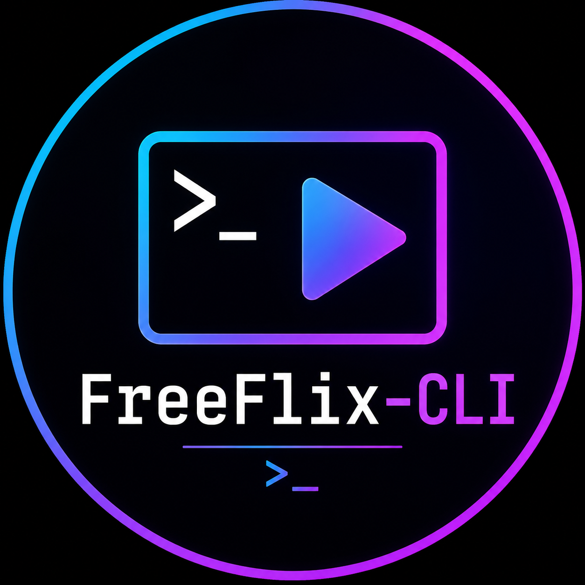

<p align="center">
  
</p>

<h1 align="center">FreeFlix CLI 🍿</h1>

<p align="center">
  <a href="https://pypi.org/project/freeflix-cli/"></a>
  <a href="https://github.com/freedy237/freeflix-cli/actions/workflows/ci.yml"></a>
  <a href="https://pypi.org/project/freeflix-cli/"></a>
  <a href="LICENSE"></a>
</p>

<p align="center">
  <em>Watch movies, series and anime from your terminal — multi-language, multi-source, no browser, no ads.</em>
</p>

<p align="center">
  <b>🎬 Movies · 📺 Series · 🍿 Anime (VF / VOSTFR / VO)</b><br>
  <sub>mpv/VLC-powered · live football · Anime4K opt-in · downloads · resume · AniList sync</sub>
</p>

<p align="center">
  <code>uv tool install freeflix-cli</code> &nbsp;·&nbsp; then run <code>freeflix</code>
</p>

---

## ⚡ Why FreeFlix

- **One command, everything works** — installs its own mpv/ffmpeg/yt-dlp and a
  Nerd Font; no browser, no ads, no accounts required.
- **Everything, always up to date** — anime (Anime-Sama, HiAnime,
  GoldenAnime), films & series (GoldenMS, Coflix, French-Stream, YTS/EZTV),
  in **French (VF/VOSTFR)** or **VO**.
- **Live planning, Match & Nouveautés** — the Anime-Sama weekly schedule, live
  football (YacineTV, Cameroon time, HD/SD/Low + Auto), and a feed of new
  episodes for the shows you follow.
- **Actually nice to use** — poster previews in the terminal (chafa), breadcrumb
  navigation, `/` to filter, `Esc` to go back anywhere, `?` for help.
- **Download & keep** — pick a quality, batch a whole season into its own folder,
  resume interrupted downloads, see ✓ watched / ▸ resume / ⬇ downloaded badges.
- **Crisp picture on demand** — Anime4K GPU upscaling pre-bundled but **off by
  default**; enable it with `CTRL+1` (max) or `CTRL+2` (light).
- **Optional AniList sync** — your progress updates automatically as you watch.

---

**FreeFlix** is a hardened, feature-extended fork of [autoflix-cli](https://github.com/PaulExplorer/autoflix-cli) by PaulExplorer. All upstream functionality is preserved ; on top of that, FreeFlix ships :

- A complete **download backend** (yt-dlp for HLS, aria2c for direct mp4, with quality selection 480p/720p/1080p) ;
- **Batch "download whole season"** ;
- **Position-in-episode resume** (mpv lua hook + tracker) ;
- **AniList sync** on watch / mark-as-watched ;
- **OpenSubtitles fallback** when a source has no subtitle ;
- **Parallel multi-episode downloads** (1–4 workers) ;
- **Daily new-episode notifications** via systemd timer + libnotify ;
- A **Nyaa torrent provider** (downloads via aria2 BitTorrent) ;
- A **Local Downloads browser** in the home menu ;
- **Live football Match** (YacineTV) : schedule in Cameroon time, LIVE badges,
  HD/SD/Low + Auto, mpv or VLC;
- **Anime4K** shaders pre-bundled but **opt-in** (CTRL+1 max, CTRL+2 light,
  CTRL+0 off), with an OSD hint at playback start;
- **Player configs isolated** : mpv uses a dedicated `--config-dir` (or
  `--no-config`), VLC runs with `--ignore-config`; your machine's own player
  settings are never read or modified;
- **French localisation** of the whole UI (auto-switched based on language pref) ;
- Multi-mirror portal fallback + `website_origin` caching (24 h TTL) ;
- Multiple **bug fixes** : 403 on `/catalogue/?search=` (animes-sama.fr refactor), double-slash legacy URLs in history, settings-menu exit loop, ffmpeg infinite-reconnect at byte 1506, Videasy/Vidlink Referer not propagated, history resume silent-failure, and more.

> ⚠️ FreeFlix is a community fork. The original project is **autoflix-cli** by PaulExplorer ; all credit goes to him for the underlying scraping work and architecture. FreeFlix exists only to consolidate the fixes and features I personally needed.

---

## ✨ What FreeFlix gives you

| | Feature |
|---|---|
| 🎬 | Stream movies, series and anime in **VF / VOSTFR / VA / VJ / VKR / VCN** |
| 📥 | Download single episodes or **entire seasons** to `~/Downloads/FreeFlix/` |
| ▶️ | **Resume at the exact second** you left off (mpv only) |
| 🔄 | **AniList sync** : mark-as-watched on AniList automatically |
| 📝 | **OpenSubtitles** fallback when a source has no subs |
| ⚡ | **Parallel downloads** (up to 4 concurrent episodes) |
| 🔔 | **Daily notifications** when new episodes drop |
| 🌊 | **Nyaa.si torrents** (high-quality anime releases) |
| 🌐 | **10 streaming sources** : Anime-Sama, French-Anime, HiAnime, GoldenAnime, GoldenMS, Papystreaming, French-Stream, Coflix, YTS/EZTV, Nyaa |
| 🗓 | **Anime-Sama planning** live (7 days, posters, follow a show without watching it) |
| 🆕 | **Nouveautés** : new episodes of the shows you follow, cleared once watched |
| 🖱 | **Full mouse control** : hover, click, wheel, right-click back, clickable pagination |
| 🎨 | **Cinema Noir** (2.0) design system, 12 themes, reduced-motion support |
| ⚽ | **Match** : live football from YacineTV, Cameroon time, HD/SD/Low + Auto, mpv/VLC |
| 🎬 | **Browse Films, Séries & Anime** : the provider list, grouped as before |
| 🎮 | **4 player backends** : mpv, VLC, browser, download-only |
| 🇫🇷 | **French UI** : the whole CLI is in French when language is set to FR |
| 🛡 | **Anti-crash mpv config** : ytdl-hook off, gpu renderer, no infinite reconnect |
| 🎨 | **Anime4K** pre-bundled, **off by default** — CTRL+1 max, CTRL+2 light, CTRL+0 off |
| 🔒 | **Player configs isolated** — global mpv/VLC settings untouched |
| 🩺 | **`freeflix --doctor`** system diagnostic (check deps, config, network) |
| 🔄 | **Startup updater** : asks yes/no, upgrades with the same installer (uv/pipx/pip), reloads |

---

## 📦 Installation

### 🚀 One-liner (anything with Python ≥ 3.9)

No git, no package manager, no sudo needed. Just Python (or PowerShell on Windows).

```bash
# Linux / macOS
curl -fsSL https://raw.githubusercontent.com/freedy237/freeflix-cli/main/scripts/install.py | python3

# Windows (PowerShell)
powershell -c "iwr -useb https://raw.githubusercontent.com/freedy237/freeflix-cli/main/scripts/install.ps1 | iex"
```

This installs `uv` if missing, then `freeflix-cli`.

### From PyPI (if you already have the system deps)

If `mpv`, `yt-dlp`, `ffmpeg`, `aria2` and `libnotify` are installed :

```bash
uv tool install freeflix-cli     # recommended
# or
pipx install freeflix-cli
# or
pip install --user freeflix-cli
```

Then :

```bash
freeflix
```

### Linux (install script — system deps + Anime4K shaders)

```bash
git clone https://github.com/freedy237/freeflix-cli.git
cd freeflix-cli
chmod +x scripts/install.sh
./scripts/install.sh
```

### macOS (install script — system deps + Anime4K shaders)

```bash
git clone https://github.com/freedy237/freeflix-cli.git
cd freeflix-cli
chmod +x scripts/install-mac.sh
./scripts/install-mac.sh
```

### Windows (install script — system deps + Anime4K shaders)

```powershell
git clone https://github.com/freedy237/freeflix-cli.git
cd freeflix-cli
powershell -ExecutionPolicy Bypass -File .\scripts\install.ps1
```

### From source (developer mode)

```bash
git clone https://github.com/freedy237/freeflix-cli.git
cd freeflix-cli
uv sync                       # dev environment (Python 3.12 recommended)
uv run freeflix               # launch from the checkout
```

Run the suite and the same lint as CI before touching a scraper:

```bash
uv run --with pytest --with pytest-cov --with pytest-timeout -m pytest -q --timeout=120
uvx ruff check --select E,W,F,B --ignore E501,E402 src/freeflix_cli/
freeflix --doctor --sources   # live audit of every source (needs network)
```

The architecture, usage, troubleshooting and release process are documented
in [`docs/`](docs/README.md). Tests are offline by design; the only network
checks live in `tools/audit_providers.py` and `--doctor --sources`.
Security model and reporting: [`SECURITY.md`](SECURITY.md).

### Upgrading on Windows (read this first)

On Windows there are two distribution channels — pick **one**:

- `uv tool` install → upgrade with `uv tool upgrade freeflix-cli`
  (**close FreeFlix first**, locked files break the upgrade)
- standalone `freeflix-windows-x86_64.exe` → re-download it from
  [GitHub Releases](https://github.com/freedy237/freeflix-cli/releases)
  (no package command can update the .exe)

If the version looks new but players/search behave like the old one
(mixed install — a second install shadowing PATH or a partial upgrade),
run `freeflix --doctor` and check the INSTALL section, then clean up:

```powershell
where.exe freeflix
uv tool uninstall freeflix-cli
uv tool install freeflix-cli
```

---

## 🚀 Usage

```bash
freeflix
```

That's it. The menu walks you through everything.

- **Films, Séries & Anime** opens the provider list (unchanged grouping).
- **Match** shows live/upcoming football with kick-off in Cameroon time
  (UTC+1); pick a match, then HD/SD/Low or **Auto**, then mpv or VLC.
- Player settings are isolated: FreeFlix never edits your global mpv/VLC
  configuration.

### Common keyboard shortcuts in mpv

| Key | Action |
|---|---|
| **CTRL + 1** | Enable Anime4K Mode A_VL (max) |
| **CTRL + 2** | Enable Anime4K Mode A_S (light) |
| **CTRL + 0** | Disable Anime4K (default) |
| **`#`** | Cycle audio track |
| **`j`** | Cycle subtitle track |
| **`_`** (Shift + `-`) | Cycle video track |
| **ALT + V** | Cycle video track (alias) |
| **ALT + 1 / 2 / 3** | Force video track #1 / #2 / #3 |
| **ALT + T** | Show track diagnostics |
| **`i`** | Toggle mpv stats overlay |

### Hybrid laptops (Intel/AMD iGPU + Nvidia dGPU)

If you're on a Linux Optimus laptop, FreeFlix detects the dGPU (Nvidia via `nvidia-smi`, AMD via `lspci`) and routes mpv onto it automatically (no FPS drop with Anime4K). To also have this when launching `mpv` standalone (outside FreeFlix), copy the wrapper :

```bash
cp scripts/wrappers/mpv ~/.local/bin/mpv
chmod +x ~/.local/bin/mpv
```

(Make sure `~/.local/bin` is in your `$PATH` before `/usr/bin`.)
The Linux `install.sh` does this for you when it detects an Nvidia card.

### Settings menu

`freeflix → ⚙ Settings (AniList)` exposes :

- **AniList Token** — paste the OAuth token from anilist.co to enable sync ;
- **Language** — switches the UI (FR / EN) and default subtitle language ;
- **Default Player** — mpv / vlc / browser / download / manual ;
- **Download Quality** — auto / 1080 / 720 / 480 ;
- **OpenSubtitles API Key** — register free at [opensubtitles.com/en/consumers](https://www.opensubtitles.com/en/consumers) ;
- **Parallel Downloads** — number of concurrent batch workers (1–4) ;
- **Daily New-Episode Notifications** — enables a `systemd --user` timer that scans Anime-Sama history once a day.

---

## 🤝 Credits

- **Original project** : [autoflix-cli](https://github.com/PaulExplorer/autoflix-cli) by [PaulExplorer](https://github.com/PaulExplorer) — all the heavy scraping lift comes from there.
- **Anime4K shaders** : [bloc97/Anime4K](https://github.com/bloc97/Anime4K).
- **mpv** : their respective authors.
- **GitHub: [@freedy237](https://github.com/freedy237)** — fork maintainer.

## ⚠️ Disclaimer

This notice is to inform you that **FreeFlix** functions strictly as an automated search tool and specialized browser. It fetches video file metadata and links from the internet in a manner similar to any standard web browser.

- **No Hosting:** FreeFlix does not host, store, or distribute any media files or copyrighted content. All content accessed through this tool is hosted by independent third-party websites.
- **DMCA Compliance:** This software does not violate the provisions of the Digital Millennium Copyright Act (DMCA) as it only provides access to publicly available links and does not store copies of any content on its own servers.
- **User Responsibility:** The use of this software and the legality of streaming content are the sole responsibility of the user, based on their respective country's or state's laws.
- **Copyright Holders:** If you believe any content accessed through this tool violates your intellectual property, please contact the actual file hosts or the websites providing the streams, as the developers of this repository have no control over or access to the hosted content.

This project is for **educational purposes only**.

---

## 📜 License

GNU General Public License v3.0 — same as upstream. See [LICENSE](./LICENSE).
